# Учебный планер — Telegram Mini App

Мини-приложение для студента: предметы, задания с дедлайнами и статусами, прогресс по каждому курсу и список всего несданного. Открывается прямо в Telegram, работает и как обычный сайт на телефоне. Данные хранятся у пользователя (Telegram CloudStorage), сервер и база не нужны.

Демо: https://malishq.github.io/study-planner-miniapp/ — бот [@study_planner_demo_bot](https://t.me/study_planner_demo_bot).

Демо для портфолио: компания вымышленная, цены и имена — примеры.

## Что умеет

- Предметы: название, цвет, преподаватель, форма контроля (зачёт или экзамен).
- Задания: предмет, название, дедлайн, тип (практика, лабораторная, тест, курсовая, рабочая тетрадь), статус (не сдано, сдано, проверено с оценкой), заметка и ссылка.
- «Неделя»: полоса ближайших семи дней с отметками по дням, просроченное сверху, подписи «сегодня», «завтра», «через 2 дня», «3 дня назад».
- «Предметы»: сдано X из Y по каждому предмету с полосой прогресса; внутри предмета — его задания и кнопка «Добавить задание».
- «Календарь»: месяц с цветными отметками по дням, список заданий на выбранный день, добавление задания на выбранную дату.
- «Несданное»: всё, что не сдано, по срокам: просрочено, ближайшие 7 дней, позже.
- Отметка «сдано» одним нажатием, редактирование в нижней шторке, удаление с подтверждением.
- Настройки: тема (как в Telegram, светлая, тёмная), экспорт и импорт JSON, демо-данные, очистка.
- Интеграция с Telegram: MainButton «Сохранить», BackButton, HapticFeedback, тема из `themeParams`, безопасные отступы, CloudStorage с кэшем в localStorage. Вне Telegram всё заменяется обычными кнопками и localStorage.
- Бот: `/start` с кнопкой «Открыть планер», кнопка меню с мини-приложением, `/help`, `/about`.

## Стек

- Мини-приложение: Vite 8, React 19, TypeScript, Tailwind CSS 4, GSAP (входы списков, переходы экранов, анимация прогресса, шторка), Telegram WebApp SDK через типизированную обёртку `src/lib/telegram.ts`. Шрифт Golos Text (Google Fonts). Тесты логики — Vitest.
- Бот: Python 3.9+, aiogram 3.22, python-dotenv. Без базы данных.
- Хостинг демо: GitHub Pages (ветка `gh-pages`, скрипт `scripts/deploy.sh`).

## Скриншоты

| Неделя | Предметы | Предмет |
| --- | --- | --- |
| 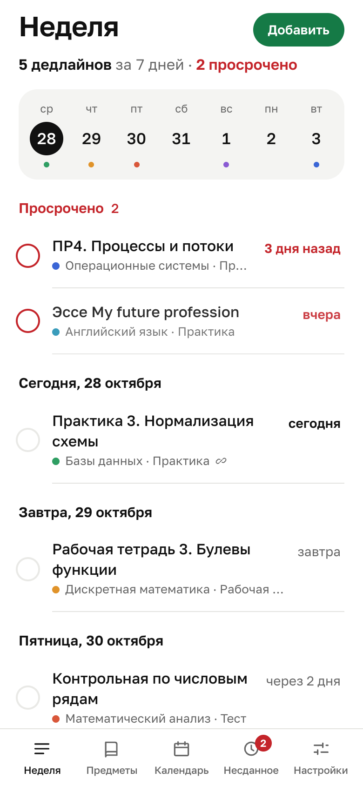 | 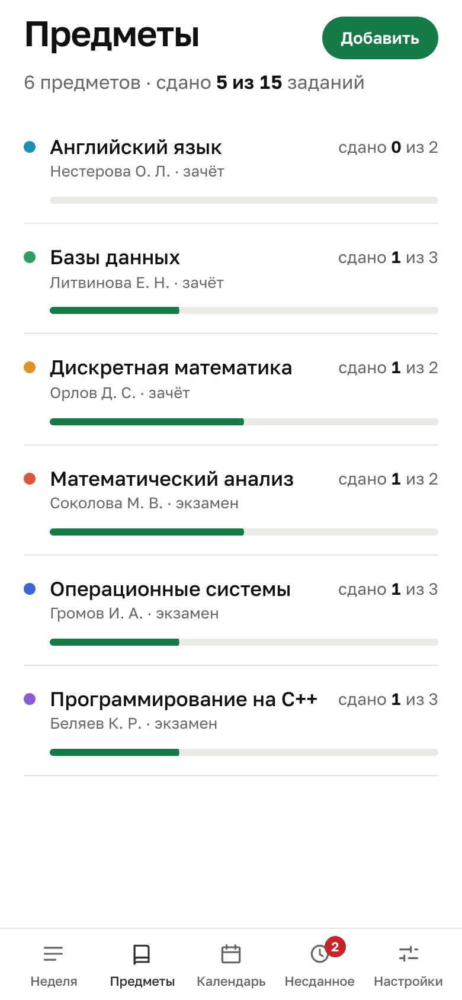 | 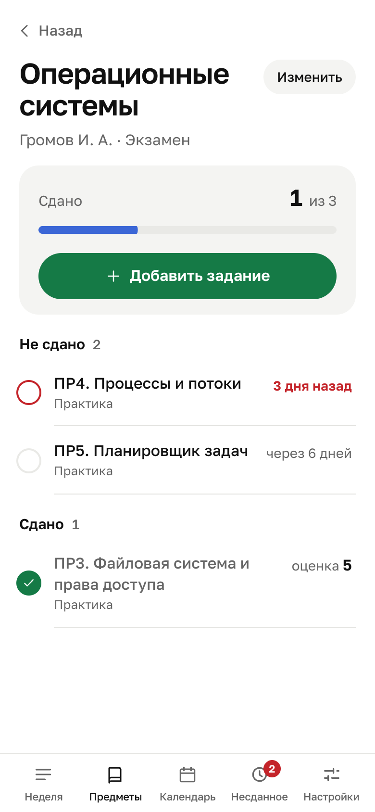 |

| Календарь | Несданное | Задание |
| --- | --- | --- |
| 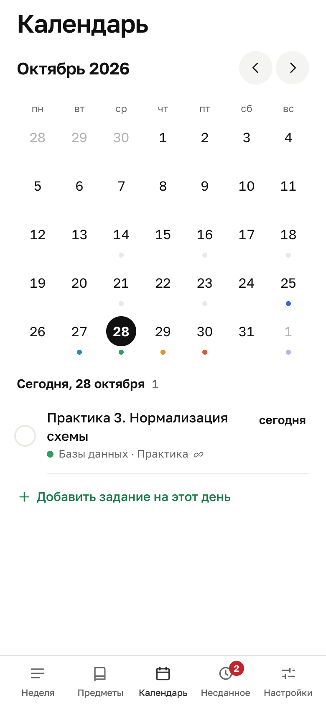 | 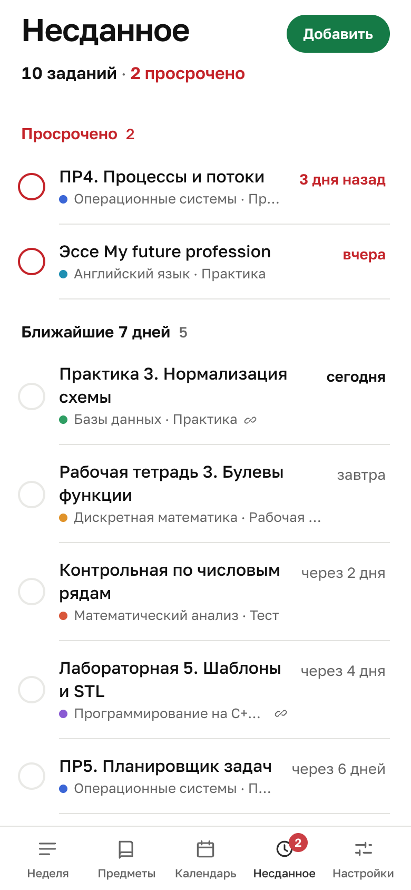 | 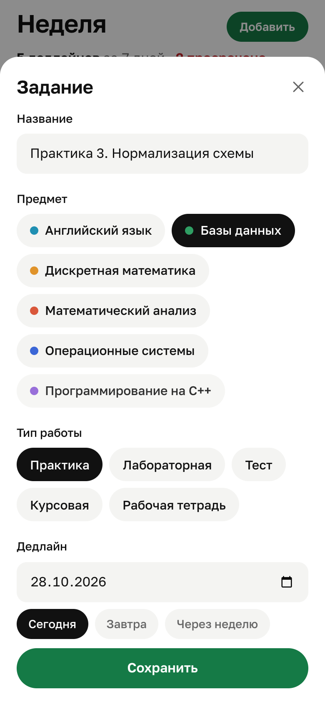 |

| Настройки | Тёмная тема | Несданное, тёмная |
| --- | --- | --- |
| 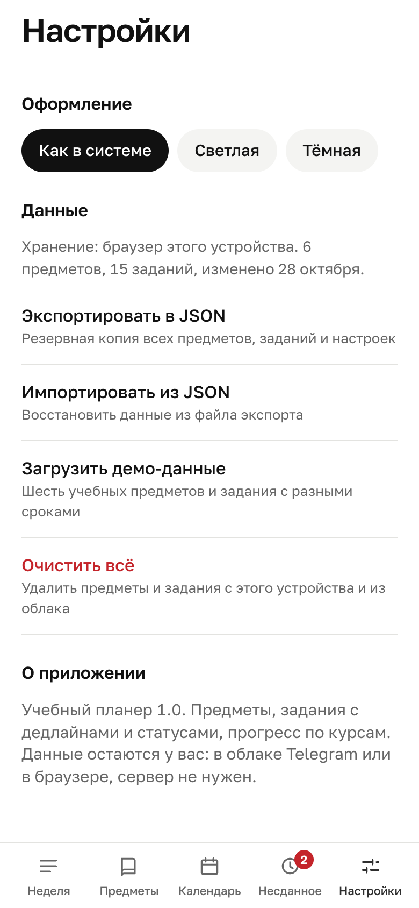 | 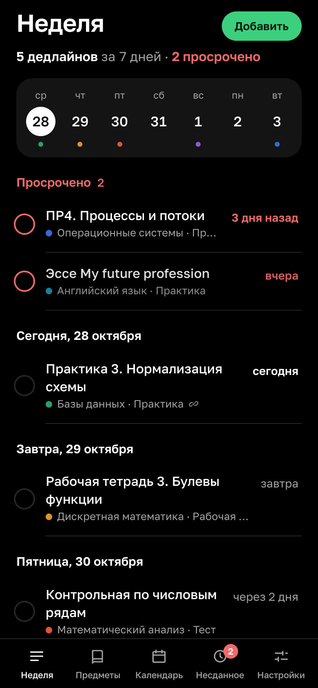 | 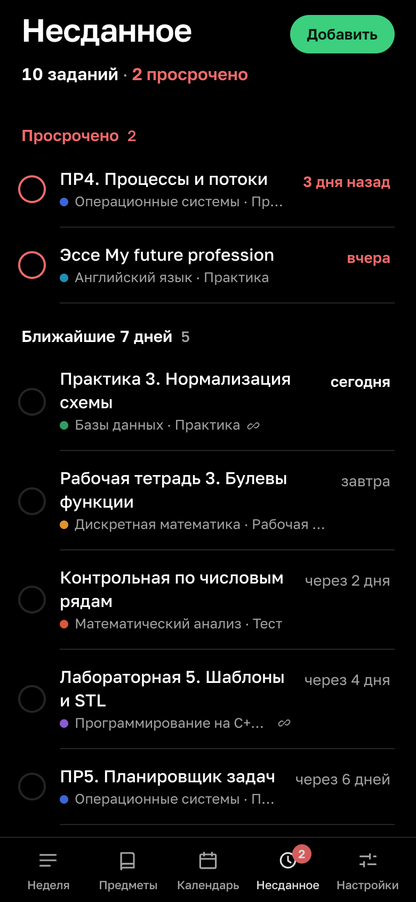 |

Десктоп (1280): 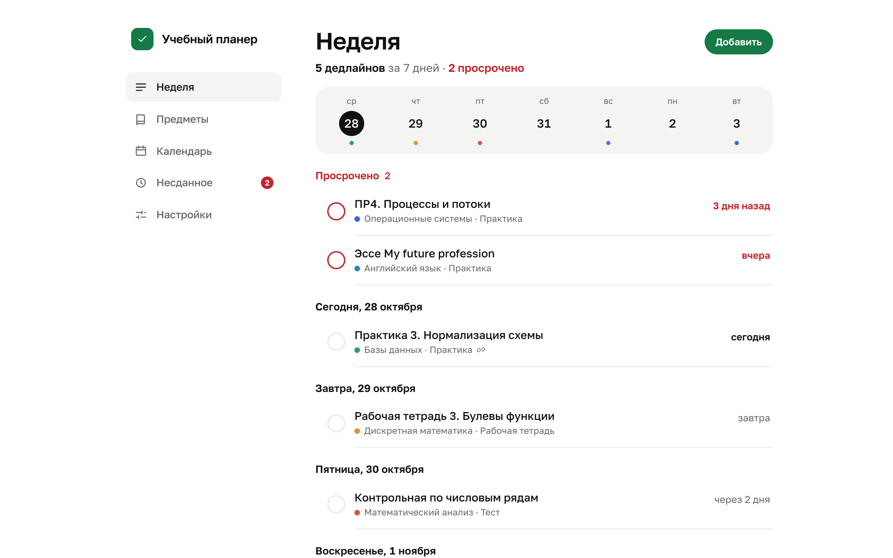

Остальные размеры (430×932) — в `docs/screens/`.

Бот в Telegram: `/start` с кнопкой «Открыть планер» и кнопка меню слева от поля ввода.

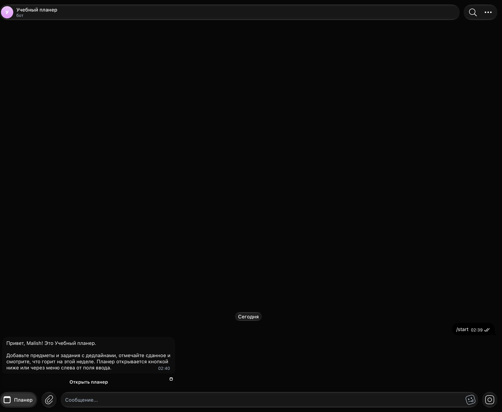

## Запуск

Мини-приложение:

```bash
npm install
npm run dev
```

Проверки и сборка: `npm test` (Vitest), `npm run build` (проверка типов и сборка в `dist/`), `npm run preview`.

Бот:

```bash
cd bot
python -m venv .venv && .venv/bin/pip install -r requirements.txt
cp .env.example .env
.venv/bin/python main.py
```

В `.env` нужны `BOT_TOKEN` от @BotFather и `WEBAPP_URL` — HTTPS-адрес мини-приложения. Тесты бота: `pip install -r requirements-dev.txt && python -m pytest`.

Docker: `cd bot && docker compose up -d --build`. VPS через systemd: unit-файл в `bot/deploy/study-planner-bot.service` (пути внутри поправить под сервер), затем `systemctl enable --now study-planner-bot`.

Деплой демо на GitHub Pages: `scripts/deploy.sh` собирает проект с базовым путём `/<имя-репозитория>/` и отправляет `dist/` в ветку `gh-pages`. Локальная сборка (`npm run build`) идёт с базовым путём `/`; другой путь задаётся переменной `BASE_PATH`.

Подключение к своему боту: в @BotFather создайте бота, укажите в `.env` его токен и адрес, где лежит сборка. При старте бот сам выставит команды, описание и кнопку меню с мини-приложением.

## Как адаптировать под клиента

- Тексты бота: `bot/app/services/texts.py` (приветствие, помощь, описание, названия команд и кнопки).
- Тексты интерфейса: по экранам в `src/screens/`, формы в `src/components/TaskForm.tsx`, названия типов работ, статусов и форм контроля — `src/lib/types.ts` (там же палитра цветов предметов).
- Цвета и шрифт: переменные в `src/index.css` (`--accent`, `--ground`, `--ink` для светлой и тёмной темы), подключение шрифта в `index.html`. Цвет Telegram MainButton — в `src/App.tsx`.
- Демо-данные: `src/lib/demo.ts`. Дедлайны задаются смещением в днях от сегодняшней даты, поэтому демо всегда выглядит актуально.
- Горизонт «Недели» (7 дней) и логика сортировки: `src/lib/logic.ts`. Словоформы и подписи дат: `src/lib/dates.ts`.
- Хранение: `src/lib/storage.ts`. В Telegram данные режутся на части по 3800 символов под лимит CloudStorage (4096 символов на ключ); при необходимости сюда же подключается свой бэкенд.
- Схема данных для импорта: JSON с полями `subjects`, `tasks`, `settings` — пример получается через «Экспортировать в JSON».

## Примерные данные

Предметы, преподаватели, задания, ссылки вида `https://example.com/...` в демо-наборе вымышлены и подлежат замене. Картинок в проекте нет: иконки и отметки нарисованы кодом (SVG и CSS).
